<!--
AUTO-GENERATED by `pnpm topology` (frontend/app/scripts/topology.mjs)
for ADR-0013 - never hand-edited. Regenerate + `git diff --exit-code`
is the CI drift gate; every figure below is extracted from:
  - apis/openapi.yaml
-->

# API surface (contract)
209 paths / 250 operations across 24 tags (DELETE 15, GET 101, PATCH 9, POST 120, PUT 5); grouped by each operation's first OpenAPI tag.

```mermaid
flowchart LR
  subgraph t0["ops - 7 operations"]
  o0_0["GET /health"]
  o0_1["GET /api/v1/meta"]
  o0_2["GET /api/v1/overview"]
  o0_3["GET /api/v1/events"]
  o0_4["GET /api/v1/audit/stats"]
  o0_5["GET /api/v1/audit/verify"]
  o0_6["GET /api/v1/audit/export"]
  end
  subgraph t1["licenses - 7 operations"]
  o1_0["GET /api/v1/licenses"]
  o1_1["POST /api/v1/licenses/import"]
  o1_2["GET /api/v1/licenses/{license_key}"]
  o1_3["GET /api/v1/licenses/{license_key}/file"]
  o1_4["POST /api/v1/licenses/{license_key}/revoke"]
  o1_5["POST /api/v1/licenses/{license_key}/restore"]
  o1_6["POST /api/v1/licenses/{license_key}/usage"]
  end
  subgraph t2["validation - 2 operations"]
  o2_0["POST /api/v1/licenses/validate"]
  o2_1["POST /api/v1/licenses/{license_key}/check"]
  end
  subgraph t3["settings - 5 operations"]
  o3_0["GET /api/v1/settings"]
  o3_1["GET /api/v1/settings/audit"]
  o3_2["PUT /api/v1/settings/{group}"]
  o3_3["POST /api/v1/settings/smtp/test"]
  o3_4["POST /api/v1/settings/scim/rotate"]
  end
  subgraph t4["vault - 9 operations"]
  o4_0["GET /api/v1/vault/stats"]
  o4_1["GET /api/v1/vault/items"]
  o4_2["POST /api/v1/vault/items"]
  o4_3["GET /api/v1/vault/items/{item_id}"]
  o4_4["POST /api/v1/vault/items/{item_id}/checkout"]
  o4_5["POST /api/v1/vault/items/{item_id}/revoke"]
  o4_6["POST /api/v1/vault/items/{item_id}/rotate"]
  o4_7["GET /api/v1/vault/events"]
  o4_8["GET /api/v1/vault/items/{item_id}/secret"]
  end
  subgraph t5["rotation - 2 operations"]
  o5_0["POST /api/v1/rotation/run"]
  o5_1["POST /api/v1/rotation/session-end"]
  end
  subgraph t6["jit - 8 operations"]
  o6_0["GET /api/v1/jit/stats"]
  o6_1["GET /api/v1/jit/requests"]
  o6_2["POST /api/v1/jit/requests"]
  o6_3["GET /api/v1/jit/requests/{request_id}"]
  o6_4["POST /api/v1/jit/requests/{request_id}/approve"]
  o6_5["POST /api/v1/jit/requests/{request_id}/deny"]
  o6_6["POST /api/v1/jit/requests/{request_id}/consume"]
  o6_7["POST /api/v1/jit/requests/{request_id}/close"]
  end
  subgraph t7["sessions - 12 operations"]
  o7_0["GET /api/v1/sessions/stats"]
  o7_1["GET /api/v1/sessions"]
  o7_2["POST /api/v1/sessions"]
  o7_3["GET /api/v1/sessions/{session_id}"]
  o7_4["GET /api/v1/sessions/{session_id}/events"]
  o7_5["POST /api/v1/sessions/{session_id}/events"]
  o7_6["POST /api/v1/sessions/{session_id}/controls"]
  o7_7["POST /api/v1/sessions/{session_id}/pause"]
  o7_8["POST /api/v1/sessions/{session_id}/lock"]
  o7_9["POST /api/v1/sessions/{session_id}/resume"]
  o7_10["POST /api/v1/sessions/{session_id}/terminate"]
  o7_11["POST /api/v1/sessions/{session_id}/complete"]
  end
  subgraph t8["command-control - 12 operations"]
  o8_0["POST /api/v1/sessions/{session_id}/events/{seq}/approve"]
  o8_1["POST /api/v1/sessions/{session_id}/events/{seq}/deny"]
  o8_2["GET /api/v1/command-control/stats"]
  o8_3["GET /api/v1/command-control/rules"]
  o8_4["POST /api/v1/command-control/rules"]
  o8_5["PUT /api/v1/command-control/rules/{rule_id}"]
  o8_6["DELETE /api/v1/command-control/rules/{rule_id}"]
  o8_7["POST /api/v1/command-control/evaluate"]
  o8_8["GET /api/v1/command-control/approvals"]
  o8_9["GET /api/v1/command-control/incidents"]
  o8_10["GET /api/v1/command-control/incidents/{incident_id}"]
  o8_11["POST /api/v1/command-control/incidents/{incident_id}/close"]
  end
  subgraph t9["discovery - 8 operations"]
  o9_0["GET /api/v1/discovery/stats"]
  o9_1["GET /api/v1/discovery/assets"]
  o9_2["POST /api/v1/discovery/assets"]
  o9_3["PATCH /api/v1/discovery/assets/{asset_id}"]
  o9_4["POST /api/v1/discovery/assets/{asset_id}/onboard"]
  o9_5["GET /api/v1/discovery/accounts"]
  o9_6["GET /api/v1/discovery/scans"]
  o9_7["POST /api/v1/discovery/scans"]
  end
  subgraph t10["risk - 6 operations"]
  o10_0["POST /api/v1/risk/evaluate"]
  o10_1["GET /api/v1/risk/evaluations"]
  o10_2["GET /api/v1/risk/stats"]
  o10_3["GET /api/v1/risk/baselines"]
  o10_4["POST /api/v1/risk/baselines/train"]
  o10_5["GET /api/v1/risk/anomalies"]
  end
  subgraph t11["bypass - 7 operations"]
  o11_0["POST /api/v1/bypass/ingest"]
  o11_1["GET /api/v1/bypass/signals"]
  o11_2["POST /api/v1/bypass/scans"]
  o11_3["GET /api/v1/bypass/incidents"]
  o11_4["GET /api/v1/bypass/incidents/{incident_id}"]
  o11_5["POST /api/v1/bypass/incidents/{incident_id}/close"]
  o11_6["GET /api/v1/bypass/stats"]
  end
  subgraph t12["break-glass - 8 operations"]
  o12_0["POST /api/v1/break-glass/requests"]
  o12_1["GET /api/v1/break-glass/requests"]
  o12_2["GET /api/v1/break-glass/requests/{request_id}"]
  o12_3["POST /api/v1/break-glass/requests/{request_id}/approve"]
  o12_4["POST /api/v1/break-glass/requests/{request_id}/deny"]
  o12_5["POST /api/v1/break-glass/requests/{request_id}/open"]
  o12_6["POST /api/v1/break-glass/requests/{request_id}/close"]
  o12_7["GET /api/v1/break-glass/stats"]
  end
  subgraph t13["integrations - 5 operations"]
  o13_0["GET /api/v1/integrations/status"]
  o13_1["POST /api/v1/mfa/enroll"]
  o13_2["POST /api/v1/mfa/verify"]
  o13_3["POST /api/v1/itsm/verify"]
  o13_4["POST /api/v1/auth/ldap"]
  end
  subgraph t14["vendors - 11 operations"]
  o14_0["GET /api/v1/vendors"]
  o14_1["POST /api/v1/vendors"]
  o14_2["GET /api/v1/vendors/{vendor_id}"]
  o14_3["PATCH /api/v1/vendors/{vendor_id}"]
  o14_4["POST /api/v1/vendors/{vendor_id}/mfa"]
  o14_5["POST /api/v1/vendors/{vendor_id}/nda"]
  o14_6["POST /api/v1/vendors/{vendor_id}/ticket"]
  o14_7["POST /api/v1/vendors/{vendor_id}/approve"]
  o14_8["POST /api/v1/vendors/{vendor_id}/deny"]
  o14_9["POST /api/v1/vendors/{vendor_id}/revoke"]
  o14_10["POST /api/v1/vendors/{vendor_id}/requests"]
  end
  subgraph t15["cloud - 9 operations"]
  o15_0["GET /api/v1/cloud/connectors"]
  o15_1["POST /api/v1/cloud/connectors"]
  o15_2["GET /api/v1/cloud/connectors/{connector_id}"]
  o15_3["PATCH /api/v1/cloud/connectors/{connector_id}"]
  o15_4["DELETE /api/v1/cloud/connectors/{connector_id}"]
  o15_5["POST /api/v1/cloud/connectors/{connector_id}/test"]
  o15_6["POST /api/v1/cloud/connectors/{connector_id}/discover"]
  o15_7["POST /api/v1/cloud/connectors/{connector_id}/rbac/requests"]
  o15_8["GET /api/v1/cloud/stats"]
  end
  subgraph t16["broker - 13 operations"]
  o16_0["GET /api/v1/broker/policies"]
  o16_1["POST /api/v1/broker/policies"]
  o16_2["GET /api/v1/broker/policies/{policy_id}"]
  o16_3["PATCH /api/v1/broker/policies/{policy_id}"]
  o16_4["DELETE /api/v1/broker/policies/{policy_id}"]
  o16_5["GET /api/v1/broker/credentials"]
  o16_6["POST /api/v1/broker/credentials"]
  o16_7["GET /api/v1/broker/credentials/{credential_id}"]
  o16_8["POST /api/v1/broker/credentials/{credential_id}/approve"]
  o16_9["POST /api/v1/broker/credentials/{credential_id}/deny"]
  o16_10["POST /api/v1/broker/credentials/{credential_id}/release"]
  o16_11["POST /api/v1/broker/credentials/{credential_id}/close"]
  o16_12["GET /api/v1/broker/stats"]
  end
  subgraph t17["agent - 15 operations"]
  o17_0["GET /api/v1/agents"]
  o17_1["POST /api/v1/agents"]
  o17_2["GET /api/v1/agents/{agent_id}"]
  o17_3["PATCH /api/v1/agents/{agent_id}"]
  o17_4["DELETE /api/v1/agents/{agent_id}"]
  o17_5["GET /api/v1/agents/{agent_id}/tasks"]
  o17_6["POST /api/v1/agents/{agent_id}/tasks"]
  o17_7["PATCH /api/v1/agents/{agent_id}/tasks/{task_id}"]
  o17_8["DELETE /api/v1/agents/{agent_id}/tasks/{task_id}"]
  o17_9["POST /api/v1/agent-access/requests"]
  o17_10["GET /api/v1/agent-access/requests"]
  o17_11["GET /api/v1/agent-access/requests/{request_id}"]
  o17_12["POST /api/v1/agent-access/requests/{request_id}/open"]
  o17_13["POST /api/v1/agent-access/requests/{request_id}/close"]
  o17_14["GET /api/v1/agent-access/stats"]
  end
  subgraph t18["cluster - 15 operations"]
  o18_0["GET /api/v1/cluster"]
  o18_1["GET /api/v1/cluster/nodes"]
  o18_2["POST /api/v1/cluster/nodes"]
  o18_3["GET /api/v1/cluster/nodes/{node_id}"]
  o18_4["PATCH /api/v1/cluster/nodes/{node_id}"]
  o18_5["DELETE /api/v1/cluster/nodes/{node_id}"]
  o18_6["POST /api/v1/cluster/nodes/{node_id}/probe"]
  o18_7["POST /api/v1/cluster/nodes/{node_id}/sync"]
  o18_8["GET /api/v1/cluster/replicas"]
  o18_9["POST /api/v1/cluster/failover"]
  o18_10["POST /api/v1/cluster/monitor/tick"]
  o18_11["GET /api/v1/cluster/backups"]
  o18_12["POST /api/v1/cluster/backups"]
  o18_13["GET /api/v1/cluster/export/vault"]
  o18_14["GET /api/v1/cluster/export/sessions"]
  end
  subgraph t19["rbac - 5 operations"]
  o19_0["GET /api/v1/roles"]
  o19_1["GET /api/v1/role-bindings"]
  o19_2["POST /api/v1/role-bindings"]
  o19_3["DELETE /api/v1/role-bindings/{binding_id}"]
  o19_4["GET /api/v1/auth/whoami"]
  end
  subgraph t20["sso - 10 operations"]
  o20_0["GET /api/v1/auth/sso/status"]
  o20_1["GET /api/v1/auth/sso/metadata"]
  o20_2["GET /api/v1/auth/sso/saml/{slot}/metadata"]
  o20_3["GET /api/v1/auth/sso/saml/{slot}/login"]
  o20_4["POST /api/v1/auth/sso/saml/{slot}/acs"]
  o20_5["GET /api/v1/auth/sso/oidc/{slot}/login"]
  o20_6["GET /api/v1/auth/sso/oidc/{slot}/callback"]
  o20_7["POST /api/v1/auth/sso/logout"]
  o20_8["GET /api/v1/auth/sso/sessions"]
  o20_9["POST /api/v1/auth/sso/sessions/{session_id}/revoke"]
  end
  subgraph t21["hsm - 4 operations"]
  o21_0["GET /api/v1/hsm/status"]
  o21_1["POST /api/v1/hsm/seal"]
  o21_2["POST /api/v1/hsm/unseal"]
  o21_3["POST /api/v1/hsm/keys/rotate"]
  end
  subgraph t22["identity - 49 operations"]
  o22_0["POST /api/v1/auth/login"]
  o22_1["POST /api/v1/auth/logout"]
  o22_2["GET /api/v1/auth/sessions"]
  o22_3["DELETE /api/v1/auth/sessions/{session_id}"]
  o22_4["POST /api/v1/auth/logout-all"]
  o22_5["POST /api/v1/auth/mfa/stepup"]
  o22_6["POST /api/v1/auth/password"]
  o22_7["POST /api/v1/auth/otp/start"]
  o22_8["POST /api/v1/auth/recovery/start"]
  o22_9["POST /api/v1/auth/recovery/reset"]
  o22_10["POST /api/v1/auth/mfa/enroll/totp"]
  o22_11["POST /api/v1/auth/mfa/enroll/totp/verify"]
  o22_12["POST /api/v1/auth/mfa/enroll/email"]
  o22_13["POST /api/v1/auth/mfa/enroll/email/verify"]
  o22_14["POST /api/v1/auth/mfa/enroll/radius"]
  o22_15["POST /api/v1/auth/mfa/backup-codes"]
  o22_16["GET /api/v1/auth/mfa/factors"]
  o22_17["DELETE /api/v1/auth/mfa/factors/{factor_id}"]
  o22_18["POST /api/v1/auth/mfa/webauthn/options"]
  o22_19["POST /api/v1/auth/mfa/webauthn/assert"]
  o22_20["POST /api/v1/auth/mfa/enroll/webauthn"]
  o22_21["GET /api/v1/auth/mfa/webauthn/credentials"]
  o22_22["DELETE /api/v1/auth/mfa/webauthn/credentials/{credential_id}"]
  o22_23["POST /api/v1/auth/factor-recovery/request"]
  o22_24["GET /api/v1/auth/factor-recovery"]
  o22_25["POST /api/v1/auth/factor-recovery/{request_id}/approve"]
  o22_26["GET /api/v1/auth/emergency"]
  o22_27["POST /api/v1/auth/emergency/open"]
  o22_28["POST /api/v1/auth/emergency/grants/{grant_id}/approve"]
  o22_29["POST /api/v1/auth/emergency/login"]
  o22_30["GET /api/v1/auth/report"]
  o22_31["GET /api/v1/auth/deliveries"]
  o22_32["GET /api/v1/users"]
  o22_33["POST /api/v1/users"]
  o22_34["PATCH /api/v1/users/{user_id}"]
  o22_35["POST /api/v1/users/{user_id}/unlock"]
  o22_36["POST /api/v1/users/{user_id}/password-reset"]
  o22_37["GET /api/v1/users/{user_id}/sessions"]
  o22_38["DELETE /api/v1/users/{user_id}/sessions"]
  o22_39["GET /api/v1/scim/v2/Users"]
  o22_40["POST /api/v1/scim/v2/Users"]
  o22_41["GET /api/v1/scim/v2/Users/{scim_id}"]
  o22_42["PUT /api/v1/scim/v2/Users/{scim_id}"]
  o22_43["PATCH /api/v1/scim/v2/Users/{scim_id}"]
  o22_44["DELETE /api/v1/scim/v2/Users/{scim_id}"]
  o22_45["GET /api/v1/scim/v2/Groups"]
  o22_46["POST /api/v1/scim/v2/Groups"]
  o22_47["GET /api/v1/scim/v2/Groups/{scim_id}"]
  o22_48["PUT /api/v1/scim/v2/Groups/{scim_id}"]
  end
  subgraph t23["gateway - 21 operations"]
  o23_0["GET /api/v1/zones"]
  o23_1["POST /api/v1/zones"]
  o23_2["GET /api/v1/zones/{zone_id}"]
  o23_3["DELETE /api/v1/zones/{zone_id}"]
  o23_4["PUT /api/v1/discovery/assets/{asset_id}/zone"]
  o23_5["GET /api/v1/gateway/pools"]
  o23_6["POST /api/v1/gateway/pools"]
  o23_7["DELETE /api/v1/gateway/pools/{pool_id}"]
  o23_8["GET /api/v1/gateway/nodes"]
  o23_9["POST /api/v1/gateway/nodes"]
  o23_10["POST /api/v1/gateway/nodes/{node_id}/approve"]
  o23_11["POST /api/v1/gateway/nodes/{node_id}/drain"]
  o23_12["DELETE /api/v1/gateway/nodes/{node_id}"]
  o23_13["POST /api/v1/gateway/nodes/{node_id}/heartbeat"]
  o23_14["GET /api/v1/gateway/nodes/{node_id}/work"]
  o23_15["GET /api/v1/gateway/sessions/{gateway_session_id}/connect-args"]
  o23_16["POST /api/v1/gateway/sessions/{gateway_session_id}/progress"]
  o23_17["GET /api/v1/gateway/sessions/{gateway_session_id}/recording"]
  o23_18["GET /api/v1/gateway/sessions/{gateway_session_id}/recording/{seq}/data"]
  o23_19["POST /api/v1/gateway/recordings/retention/run"]
  o23_20["GET /api/v1/gateway/stats"]
  end
```

