<!--
AUTO-GENERATED by `pnpm topology` (frontend/app/scripts/topology.mjs)
for ADR-0013 - never hand-edited. Regenerate + `git diff --exit-code`
is the CI drift gate; every figure below is extracted from:
  - pam_master/**/*.py (tests, test_* and conftest.py excluded)
  - backend/phase2_license_server/**/*.py (same policy)
  - backend/ipam_licensing/**/*.py (same policy)
  - python import statements resolved strictly to files that exist
-->

# Backend package map
3 packages, 43 modules, 140 drawn intra-package import edges.

```mermaid
flowchart TD
  subgraph p0["pam_master (pam_master)"]
  b0_0["pam_master/__init__.py - 14 lines"]
  b0_1["pam_master/__main__.py - 21 lines"]
  b0_2["pam_master/app.py - 22 lines"]
  b0_3["pam_master/config.py - 112 lines"]
  b0_4["pam_master/crypto.py - 83 lines"]
  b0_5["pam_master/db.py - 79 lines"]
  b0_6["pam_master/errors.py - 60 lines"]
  b0_7["pam_master/issuance.py - 629 lines"]
  b0_8["pam_master/keygen.py - 105 lines"]
  b0_9["pam_master/keys.py - 178 lines"]
  b0_10["pam_master/licensing.py - 98 lines"]
  b0_11["pam_master/registry.py - 388 lines"]
  b0_12["pam_master/routes.py - 208 lines"]
  end
  subgraph p1["phase2_license_server (backend/phase2_license_server)"]
  b1_0["app.py - 303 lines"]
  b1_1["audit.py - 1088 lines"]
  b1_2["cluster_monitor.py - 73 lines"]
  b1_3["config.py - 136 lines"]
  b1_4["errors.py - 59 lines"]
  b1_5["extensions.py - 7 lines"]
  b1_6["gateway_daemon.py - 424 lines"]
  b1_7["gateway.py - 1517 lines"]
  b1_8["guacd.py - 292 lines"]
  b1_9["hsm.py - 911 lines"]
  b1_10["identity.py - 1481 lines"]
  b1_11["integrations.py - 631 lines"]
  b1_12["keys.py - 95 lines"]
  b1_13["licensing_bridge.py - 102 lines"]
  b1_14["mfa.py - 309 lines"]
  b1_15["models.py - 3697 lines"]
  b1_16["otp.py - 431 lines"]
  b1_17["radius_client.py - 218 lines"]
  b1_18["rotation_scheduler.py - 67 lines"]
  b1_19["routes.py - 3944 lines"]
  b1_20["scim.py - 366 lines"]
  b1_21["secrets_store.py - 294 lines"]
  b1_22["service.py - 12781 lines"]
  b1_23["sso.py - 1313 lines"]
  b1_24["webauthn.py - 615 lines"]
  b1_25["wsgi.py - 13 lines"]
  end
  subgraph p2["ipam_licensing (backend/ipam_licensing)"]
  b2_0["license_tool.py - 544 lines"]
  b2_1["license_validator.py - 331 lines"]
  b2_2["license.py - 416 lines"]
  b2_3["signature.py - 362 lines"]
  end
  b0_0 --> b0_2
  b0_0 --> b0_3
  b0_1 --> b0_2
  b0_1 --> b0_3
  b0_2 --> b0_3
  b0_2 --> b0_12
  b0_5 --> b0_3
  b0_7 --> b0_3
  b0_7 --> b0_4
  b0_7 --> b0_5
  b0_7 --> b0_6
  b0_7 --> b0_9
  b0_7 --> b0_10
  b0_7 --> b0_11
  b0_8 --> b0_3
  b0_8 --> b0_9
  b0_10 --> b0_3
  b0_10 --> b0_9
  b0_11 --> b0_3
  b0_11 --> b0_4
  b0_11 --> b0_5
  b0_11 --> b0_6
  b0_11 --> b0_9
  b0_12 --> b0_3
  b0_12 --> b0_5
  b0_12 --> b0_6
  b0_12 --> b0_7
  b0_12 --> b0_9
  b0_12 --> b0_11
  b1_0 --> b1_1
  b1_0 --> b1_2
  b1_0 --> b1_3
  b1_0 --> b1_4
  b1_0 --> b1_5
  b1_0 --> b1_10
  b1_0 --> b1_12
  b1_0 --> b1_13
  b1_0 --> b1_15
  b1_0 --> b1_18
  b1_0 --> b1_19
  b1_0 --> b1_22
  b1_1 --> b1_5
  b1_1 --> b1_11
  b1_1 --> b1_15
  b1_1 --> b1_21
  b1_1 --> b1_22
  b1_2 --> b1_22
  b1_6 --> b1_8
  b1_7 --> b1_3
  b1_7 --> b1_4
  b1_7 --> b1_5
  b1_7 --> b1_8
  b1_7 --> b1_15
  b1_7 --> b1_21
  b1_7 --> b1_22
  b1_9 --> b1_3
  b1_9 --> b1_4
  b1_9 --> b1_5
  b1_9 --> b1_15
  b1_9 --> b1_21
  b1_10 --> b1_4
  b1_10 --> b1_5
  b1_10 --> b1_15
  b1_10 --> b1_21
  b1_12 --> b1_3
  b1_12 --> b1_13
  b1_13 --> b1_3
  b1_14 --> b1_4
  b1_14 --> b1_5
  b1_14 --> b1_10
  b1_14 --> b1_11
  b1_14 --> b1_15
  b1_14 --> b1_16
  b1_14 --> b1_17
  b1_14 --> b1_21
  b1_15 --> b1_5
  b1_15 --> b1_13
  b1_16 --> b1_4
  b1_16 --> b1_5
  b1_16 --> b1_10
  b1_16 --> b1_15
  b1_16 --> b1_21
  b1_16 --> b1_22
  b1_17 --> b1_4
  b1_17 --> b1_5
  b1_17 --> b1_10
  b1_17 --> b1_15
  b1_17 --> b1_22
  b1_18 --> b1_22
  b1_19 --> b1_3
  b1_19 --> b1_4
  b1_19 --> b1_5
  b1_19 --> b1_7
  b1_19 --> b1_9
  b1_19 --> b1_10
  b1_19 --> b1_13
  b1_19 --> b1_14
  b1_19 --> b1_15
  b1_19 --> b1_16
  b1_19 --> b1_17
  b1_19 --> b1_20
  b1_19 --> b1_22
  b1_19 --> b1_23
  b1_19 --> b1_24
  b1_20 --> b1_4
  b1_20 --> b1_5
  b1_20 --> b1_10
  b1_20 --> b1_15
  b1_20 --> b1_22
  b1_21 --> b1_3
  b1_21 --> b1_4
  b1_21 --> b1_9
  b1_21 --> b1_15
  b1_22 --> b1_1
  b1_22 --> b1_3
  b1_22 --> b1_4
  b1_22 --> b1_5
  b1_22 --> b1_7
  b1_22 --> b1_9
  b1_22 --> b1_10
  b1_22 --> b1_11
  b1_22 --> b1_13
  b1_22 --> b1_15
  b1_22 --> b1_16
  b1_22 --> b1_21
  b1_22 --> b1_23
  b1_23 --> b1_1
  b1_23 --> b1_4
  b1_23 --> b1_5
  b1_23 --> b1_15
  b1_24 --> b1_4
  b1_24 --> b1_5
  b1_24 --> b1_10
  b1_24 --> b1_14
  b1_24 --> b1_15
  b1_25 --> b1_0
  b2_0 --> b2_2
  b2_0 --> b2_3
  b2_1 --> b2_2
  b2_1 --> b2_3
```

