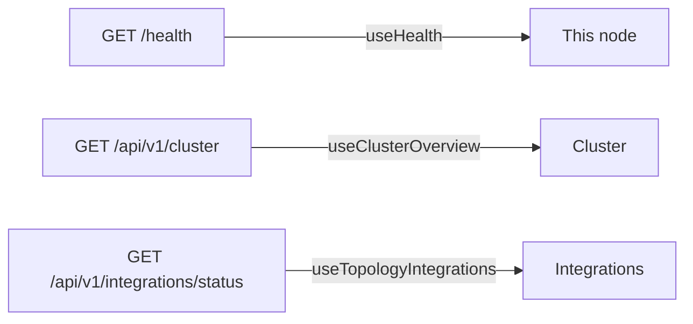

<!--
AUTO-GENERATED by `pnpm topology` (frontend/app/scripts/topology.mjs)
for ADR-0013 - never hand-edited. Regenerate + `git diff --exit-code`
is the CI drift gate; every figure below is extracted from:
  - frontend/app/src/features/topology/queries.ts (hook -> client fn)
  - frontend/app/src/features/topology/NetworkSection.tsx (card -> hook)
  - frontend/app/src/api/generated/index.ts
  - apis/openapi.yaml
-->

# Network posture wiring (live)
The Network view of `/topology` fetches these endpoints live through the generated client (`expectOk`) and renders one honest card per answer (loading / not-connected / verbatim data). This document shows the wiring; the values come from the running node.

