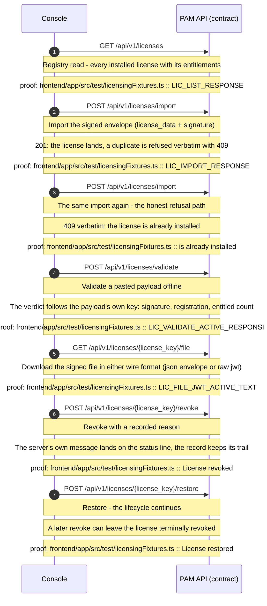
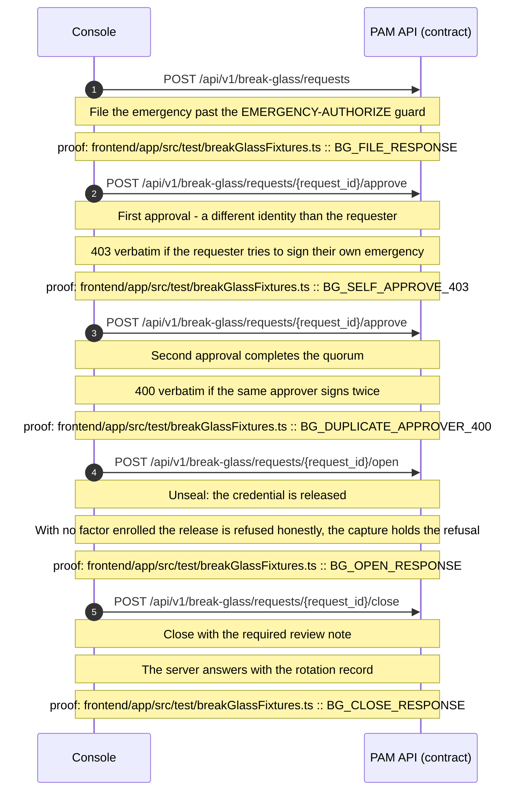
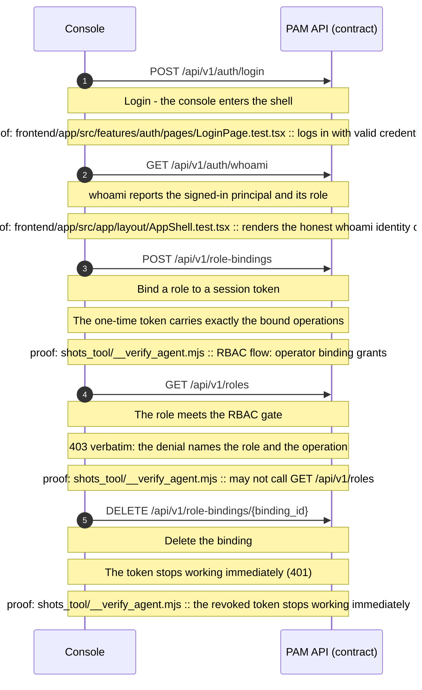
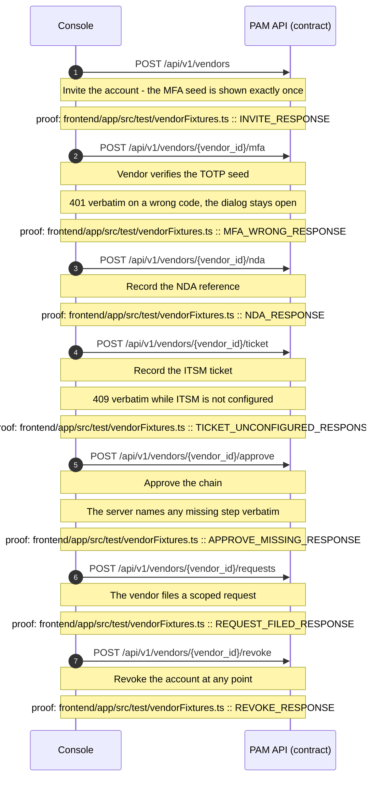
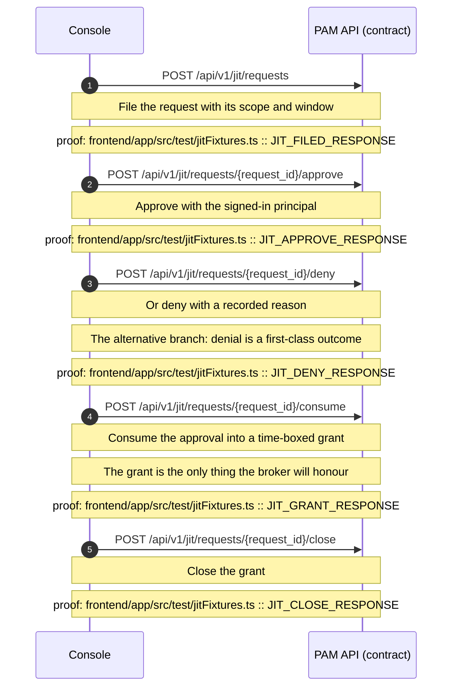

<!--
AUTO-GENERATED by `pnpm topology` (frontend/app/scripts/topology.mjs)
for ADR-0013 - never hand-edited. Regenerate + `git diff --exit-code`
is the CI drift gate; every figure below is extracted from:
  - frontend/app/src/features/topology/workflows.ts
  - frontend/app/src/i18n/en.json (step labels)
  - apis/openapi.yaml (every arrow is an operation of the contract)
  - the named proof files (fixture captures, tests, standing gate)
-->

# Application workflows (contract-true)
Five curated lifecycles: every arrow is a real contract operation and every note names the repo proof that drives the step (verbatim fixture capture, test, or standing gate).

## License lifecycle

Out-of-band mint, ingest on the node, verify offline, then revoke or restore - the server's own API throughout

## Emergency break-glass

File, dual-sign, unseal, close - every transition gated by the server

## Auth & RBAC

Login, identity, role grants, the scoped denial and the revoked token - the gate's live RBAC flow

## Vendor onboarding

Invite, prove identity, sign, ticket, approve - then scoped requests and revocation

## JIT access

Request, approve or deny, grant, close - ephemeral by construction

