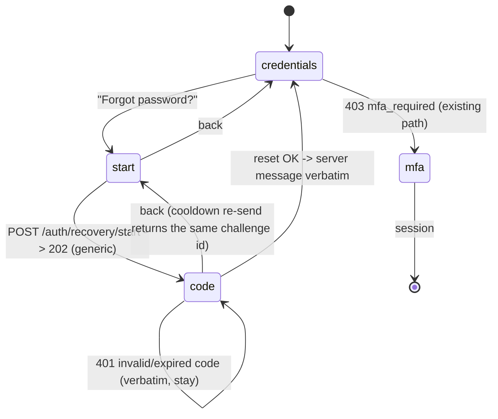

# ADR-0016: Identity operations — password recovery flow + the Users & Credentials screen

Date: 2026-10-19
Status: Accepted (user directive, 2026-10-19 overnight: "close the backend↔frontend gap; no questions; recommended path")

## Context — the gap, with evidence

`apis/openapi.yaml` declares **250 operations across 24 tags**; the generated
client (`frontend/app/src/api/generated/`) types every one of them; the console
serves 13 routes. Most tags map to a screen. The `identity` tag (49 operations)
barely does — two subsystems are fully built and tested in the backend with **no
console surface at all**:

| Evidence | Fact |
|---|---|
| `routes.py:3159-3200` | `POST /auth/otp/start`, `POST /auth/recovery/start`, `POST /auth/recovery/reset` — the forgot-password flow is backend-only; `LoginPage.tsx` implements password → session and the 403 `mfa_required` TOTP step, nothing else |
| `routes.py:3459-3556` | `GET/POST /users`, `PATCH /users/{id}`, `POST /users/{id}/unlock`, `POST /users/{id}/password-reset`, `GET/DELETE /users/{id}/sessions` — full user administration, `@require_admin`, zero pages |
| `tests/test_settings_and_ui.py:27-60` | `CANONICAL_NAV` has no users slot — **no legacy screen ever existed for user administration**, so this surface is F4-native (precedent: `/topology`, post-flip `/settings`) |
| `otp.py:261-326` | `start_otp` answers an identical generic `202 {status, challenge_id}` for every syntactically valid username — existing or not, SMTP configured or not (no enumeration, ever) |

User decisions recorded verbatim in spirit:

1. **Recovery flow**: "the forgot-password → email OTP → fill OTP → new
   password flow is backend-only right now — build it" (2026-10-19).
2. **`frontend/screens` is reference-only**: the stitch-generated legacy pages
   were "only for reference, not for actual use"; the terminal state is the
   React app alone (Decision 4 sequences it — each legacy page dies only when
   its replacement carries the contract it is verified against).

### Verbatim capture provenance (fixtures' source of truth)

A throwaway container (`vypam-capture-116`, image `vypam-rig:11.5`, **ephemeral
DB, never a standing rig**) produced `Temp/capture116.json` on 2026-10-19 via
`Temp/capture116.py`. Every fixture in `frontend/app/src/test/usersFixtures.ts`
and the recovery tests is byte-copied from it. The captures include the
anti-enumeration proof: `recovery/start` for an existing user and for
`nobody.here` answer the **identical shape** (`202 {status:"sent",
challenge_id}` — only the random id differs).

## Decision 1 — recovery flow on the login card (batch 11.6)

- **Step 1** `POST /auth/recovery/start {username}` → the verbatim generic
  `202 {"status":"sent","challenge_id":"<hex32>"}`. Display copy states the
  contract honestly (i18n key, no enumeration): the answer is the same whether
  or not the account exists, and on a rig without SMTP the code is minted but
  suppressed (OpenAPI description: "the honest suppression on the `auth`
  trail").
- **Step 2** `POST /auth/recovery/reset {username, challenge_id, code,
  new_password}`:
  - success → the server's own message rendered **verbatim**
    (`Password reset - sign in again`), then back to the sign-in view;
  - `401 {"error":"One-time code invalid or expired"}` rendered verbatim
    (captured), the challenge stays open for another attempt (attempt cap is
    the server's);
  - `400` policy refusals verbatim — the captured minimum is
    `Password must be at least 14 characters (NIST: length over complexity)`
    (`details.min_length: 14`, captured), which the Zod schema mirrors as
    `min(14)` (ADR-0006 rule: client mirrors contract limits, server is
    always authoritative);
  - transport failure → the shared honest backend-down line.
- **Not capturable**: the reset **success** arm. Standing and capture rigs have
  no SMTP delivery, so a real code can never arrive; per the established rule
  (failover precedent, `settingsFixtures.ts`) the success fixture is a
  documented contract-shape literal — `{user, sessions_revoked, message}` —
  with the honest comment, never a rig-fiction.

## Decision 2 — Users & Credentials screen (batch 11.7, route `/users`)

- **Read**: `GET /users` → the captured row shape verbatim (16 fields:
  `username, display_name, email, source, is_active, is_emergency,
  must_change_password, locked_until, failed_logins, lockout_streak,
  last_login_at, password_changed_at, created_at, created_by, has_password,
  id`). Status chips derive from the captured fields only: locked
  (`locked_until`), inactive (`!is_active`), must-change
  (`must_change_password`), emergency (`is_emergency`).
- **Writes**, each rendering the server's captured `message` verbatim:
  | Action | Endpoint | Captured answer |
  |---|---|---|
  | Deactivate / reactivate | `PATCH /users/{id}` | `User updated` (+ session revocation on deactivate) |
  | Unlock | `POST /users/{id}/unlock` | `User unlocked` |
  | Reset password | `POST /users/{id}/password-reset` | `Password reset - every session revoked`, `generated_password` shown **once** in a feedback box with copy |
  | Revoke sessions | `DELETE /users/{id}/sessions` | `0 session(s) revoked` (`{revoked, message}`) |
  | Create | `POST /users` | `User created` (+ `generated_password` shown once when no password was given) |
- **No delete action exists and none is faked**: the contract's lifecycle is
  deactivate (`PATCH active:false` — the captured row keeps its id and history
  as evidence). Captured refusals render verbatim: `409 User 'ops.user'
  already exists`, `401 Admin token required (Authorization: Bearer <token> or
  X-Admin-Token)` (a non-admin console session sees this honestly).
- **F4-native**: nav item without `legacyHref` (ADR-0013 invariant holds
  because the route is implemented in the same batch); one `['users']` query
  root; every mutation invalidates it.

## Decision 3 — gap inventory (all 24 tags, honest classification)

| Class | Tags |
|---|---|
| **Served** (console screen covers the tag's operator surface) | `ops`, `licenses`+`validation`, `settings`, `vault`+`rotation`, `jit`, `sessions`, `command-control`+`risk`, `discovery`, `break-glass`, `rbac`, `sso`, `hsm`, `integrations` (chips + MFA/ITSM/LDAP actions), `vendors` (chain), `agent`+`broker` (queues + actions), `bypass` (reads) |
| **Partial** (real surface, some writes unwired) | `cloud` (list/test/discover; `rbac/requests` missing), `cluster` (posture/failover/backups served; node register/probe/sync/monitor-tick/exports missing), `bypass` (ingest/scan/close writes), `vendors` (PATCH edit), `command-control` (incident detail) |
| **API-plane by design** (no console page warranted) | `gateway` node plane (node tokens: heartbeat/work/connect-args/recording), `identity` SCIM 2.0 (inbound IdP plane), SAML/OIDC protocol endpoints (browser redirects) |
| **Gap → landed by this ADR** | `identity`: recovery flow (**11.6**), users administration (**11.7**) |
| **Gap → proposed batches** (not committed here) | **11.8** factor-recovery two-admin queue + `auth/report` auditor view (compliance fold); **11.9** gateway fleet admin (zones/pools/nodes approve/drain/revoke + stats) — the largest basic-PAM gap; **11.10** cluster node admin on the settings cluster section; **account self-service** (own console sessions, `POST /auth/password`, MFA factor management) as a top-bar Account page |

## Decision 4 — terminal sequence for `frontend/screens`

The gate (`shots_tool/__verify_agent.mjs`) is the contract for exactly three
legacy pages (JIT `:31-92`, Compliance `:93-115`, Hub `:116-329`); settings
died at 11.5. The other nine folders are verified only by the backend
canonical-nav suite. Sequence ordered by cost:

| Order | Work | Contract to honour |
|---|---|---|
| **T1** | Delete the two **spec screens** (`enterprise_licensing_tier_entitlements_node_quotas`, `platform_settings_idp_hsm_configuration`) | `OWN_INDEX` shrinks; no other sidebar names a spec folder (hrefs always target live folders) — prove with `test_every_screen_has_the_canonical_nav` |
| **T2** | Strangle the **nine non-gate live screens** in 2-3 batches (command-center, vault, policy, infrastructure, vendor, break-glass, licensing, + the T1 leftovers): server redirect route → `/app/<route>`, each remaining sidebar slot updated (11.5 pattern), `WIRED_SCREENS` shrinks, folder deleted, React `legacyHref` removed | React screen passes its own vitest+axe battery **plus a section-parity sweep against the legacy page before it dies** (the gate never covered these, so the sweep is the read-surface contract); gate stays green untouched |
| **T3** | **Compliance flip** (smallest gate block: 22 source chips incl. auth+gateway, rbac labels, zero errors) | React screen renders the chips with gate-readable hooks → gate block re-pointed to `/app/compliance` |
| **T4** | **JIT flip** (agent section below broker, summary regex, tiles, tables, register modal, `no id=`, `jitLive` export) | same 11.5 treatment as settings |
| **T5** | **Hub flip** (gateway overlay line, inline asset→vault flows, `hubLive` export — largest block) | same 11.5 treatment |
| **T∞** | `frontend/screens` removed; `WIRED_SCREENS` empty; gate visits zero legacy pages | ledger row per batch, CI 6/6 per SHA |

## Batch table

| Batch | Content | Verified by |
|---|---|---|
| **11.6** | This ADR + recovery flow on `LoginPage` (schemas, i18n, tests) | vitest + axe; gate both modes (regression) |
| **11.7** | `/users` screen: queries + page + nav/router/i18n + verbatim fixtures + tests; topology regen | vitest + axe; backend nav suite; gate both modes |

## Cross-cutting rules

1. Copy through i18n keys only (ADR-0010); server messages rendered verbatim.
2. Honest states: no loading after settle; dead backend → shared honest line;
   absent data → `—`; generated passwords shown once and never persisted.
3. Fixtures byte-copied from `Temp/capture116.json`; the one non-capturable
   arm carries an honest contract-shape comment.
4. Gate green in both modes before every commit; gitleaks on staged; CI 6/6
   per pushed SHA; ledger row per landed batch.

## Consequences

- The console covers the whole forgot-password contract and the user
  administration contract; `identity`'s remaining operator gaps move to the
  proposed 11.8-11.10 list.
- `/users` is the first F4-native screen after `/topology`: the sidebar grows
  one entry the legacy suite does not know, which its tests must accept
  (nav-item-without-legacyHref ⇒ implemented — enforced by the router type
  predicate).
- `frontend/screens` deletion becomes an ordered, per-batch contract instead
  of an aspiration: every batch names the test that must shrink with it.
