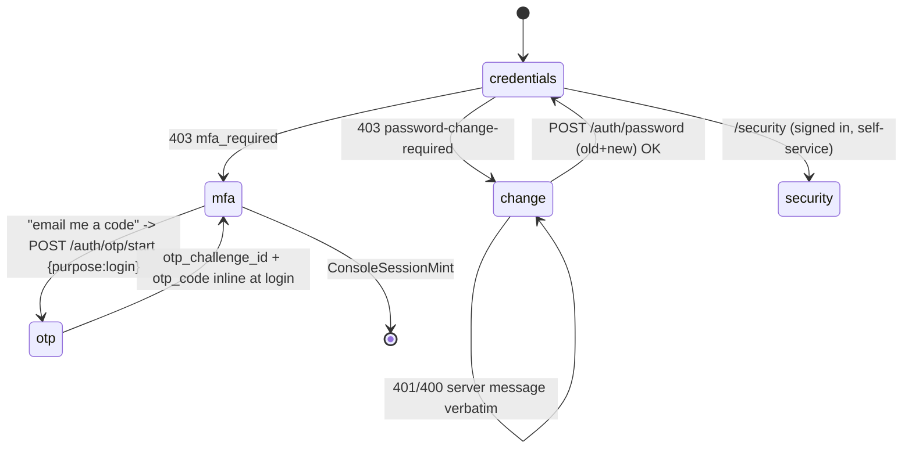

# ADR-0017: Identity hardening - forced password change, self-service MFA, per-user machine access, two-officer admin changes

Date: 2026-10-19
Status: Accepted (user directive, 2026-10-19: "do the needful without any vibe coding" - approves the four-batch plan; batch 11.8 first)

## Context - the "no-LDAP company" story, with evidence

A company that bought PAM has no directory: PAM's local identity IS the
directory (ADR-0016 shipped the recovery flow and the Users screen against
it). The user's remaining asks, mapped against the contract before any code
(no vibe coding - every row is a checked fact):

| User ask | Contract fact | Evidence | Gap |
|---|---|---|---|
| create users, assign permissions | exists: `POST /api/v1/users` + RBAC bindings | routes.py:3459+, routes.py:2800 | console ergonomics (below) |
| give a user access to **only** the machines they need | exists: `RoleBinding.scope.targets` = fnmatch patterns, enforced on `POST /sessions` and vault checkout | apis/openapi.yaml:10633-10675; routes.py:206-230; call sites routes.py:916/927/938/945/1109 | a per-user Access view; no `PATCH /users/{id}` force-change flag |
| OTP + MFA must be required | exists: `auth.mfa_required` (default **true**, fail-closed `enrolment_required`), TOTP/email-OTP/RADIUS/WebAuthn/backup codes | identity.py:929-940; identity.py:161; openapi:5156-5550 | the console has no self-service enrolment screen and no email-OTP login option |
| admin marks "change password" for a user; next login the user changes it | half: admin reset sets `must_change_password` (identity.py:481); login then 403s `password-change-required` (identity.py:909-917); `POST /auth/password` (old+new, NIST-14, revokes other sessions, clears the flag) exists (identity.py:1084-1119). But `PATCH /users/{id}` accepts only `active/email/display_name` | openapi:6137-6146 | (a) PATCH flag, (b) the login card that answers the 403 |
| **two officers required for every admin change** | pattern proven - break-glass needs 2 approvals with requester refusal (service.py:7070-7233), emergency-open needs 2 (identity.py:110,1330-1374), gateway nodes are maker-checker with self-approval refused **verbatim** (gateway.py:483-487), factor-recovery needs 2 admins (identity.py:1175-1228), the `approver` role exists in the role model | as cited | **not applied** to settings writes, user management, or binding changes - all single-actor today |

## Decision 1 - batch 11.8 (frontend, existing contract only)

The login card learns two states the backend already answers, and a new
`/security` screen speaks the already-built MFA surface:

- **forced change**: the verbatim 403 carries `details.reason:
  "password-change-required"`; the card posts `{username, old_password,
  new_password}` to `POST /auth/password` (it works signed-out - the
  contract's forced-first-login path, openapi:5196-5232) and re-enters
  sign-in with the username prefilled on success.
- **email-OTP login**: the MFA step offers "email me a code"
  (`POST /auth/otp/start {username, purpose: "login"}` verbatim generic
  `202`), then the login retry carries `otp_challenge_id + otp_code`
  inline (openapi:5029-5030). Same anti-enumeration copy rules as the
  recovery flow (ADR-0016).
- **/security screen** (F4-native nav item, no legacy page ever had it):
  factors list + delete (`GET/DELETE /auth/mfa/factors*`), TOTP enrol
  (seed + otpauth URI shown once, then the first-code verify), backup
  codes (`POST /auth/mfa/backup-codes`, ten single-use codes shown once),
  e-mail enrol (generic 202 + the captured refusals), and the RADIUS
  honest state - the captured 503 while the `radius` group is
  unconfigured (`routes.py:3301`, `radius_client.py:195`). WebAuthn
  registration needs a full browser ceremony (`/auth/mfa/webauthn/options`
  -> `navigator.credentials.create` -> `/auth/mfa/enroll/webauthn`) and is
  deliberately out of this batch; the factor table already renders any
  provisioned security-key rows, and the register refusal for an
  unconfigured `webauthn` group is source-verified at
  `webauthn.py:399-404`.

## Decision 2 - batch 11.9 (backend + frontend)

- `PATCH /api/v1/users/{id}` gains **`must_change_password`** (boolean,
  optional): the admin can mark a user "change password at next sign-in"
  **without** resetting anything. Refusals mirror the route's existing
  ones (SCIM 403, emergency 403, 404). Audit `user.must_change_password`
  diff on the existing `user` trail. The Users screen gains "Require
  password change" / "Clear" next to the existing actions (confirm-gated,
  verbatim questions).
- **Access tab** on `/users`: the user's role-bindings
  (`GET /role-bindings`, create `POST /role-bindings {principal, role,
  kind: user, scope.targets}`, revoke `DELETE .../{id}`) with the target
  patterns offered as a picker over the real discovery assets
  (`GET /discovery/assets`) plus free text - the fnmatch contract is
  documented inline ("`db-prod-*:22` style; empty scope = everywhere").
  The Settings RBAC section keeps its machine-facing one-time-token flow;
  this view is the human-facing one.

## Decision 3 - batch 12.0 (backend + frontend, the flagship)

A generic **two-officer change request** over the three single-actor admin
surfaces - `PUT /settings/{group}`, `POST/PATCH /users*`,
`POST/DELETE /role-bindings` - reusing the proven house pattern:

- `ChangeRequest` model: `kind` (settings|user|binding), a payload
  snapshot + a human summary, `requested_by`, `status`
  pending|approved|applied|rejected|expired, `approved_by`, timestamps.
- `POST /change-requests` creates `pending` (the maker's console session
  is the requester); `POST /change-requests/{id}/approve` applies it - the
  approver must be a **different officer** (self-approval refused
  verbatim, gateway.py precedent) and the count of distinct approvals
  must reach `zsp.tier0_quorum_approvers` (default 2 - today only a
  posture metric, service.py:4665; it becomes the enforcement knob).
- the console gains a Pending approvals inbox for approvers and the three
  admin surfaces show "needs a second officer" pending states instead of
  pretending the write landed.
- emergency paths stay as they are (break-glass/emergency-open already
  have their own two-officer flows - this generalizes the *routine* case).

## Batch table

| Batch | Surface | Contract delta | Evidence bar |
|---|---|---|---|
| 11.8 | console | none (existing endpoints) | vitest+axe both login states + /security; gate both modes unchanged |
| 11.9 | console + openapi | `PATCH /users/{id}.must_change_password` | backend contract+route tests, vitest+axe, capture on a throwaway rig |
| 12.0 | console + openapi + models | `change-requests` surface | backend dual-control tests (incl. self-approval refusal), vitest+axe inbox, gate both modes |

Cross-reference: ADR-0018 (first-run setup) reuses Decision 1's forced
change card for the bootstrap officers and Decision 3's two-officer rule
for everything after setup.
