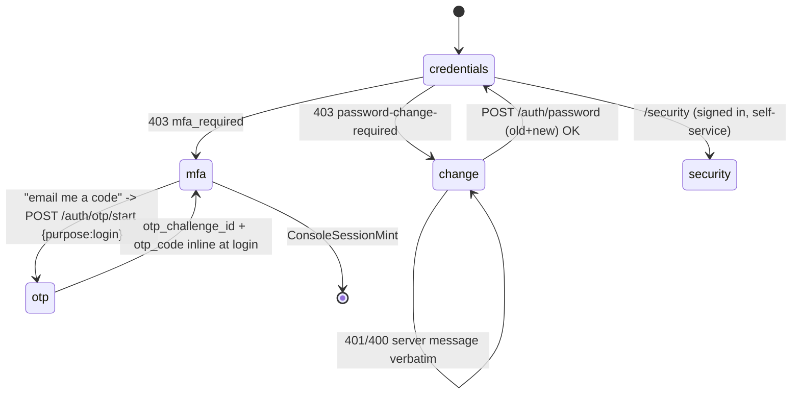

# ADR-0017: Identity hardening - forced password change, self-service MFA, per-user machine access, two-officer admin changes

Date: 2026-10-19
Status: Accepted (user directive, 2026-10-19: "do the needful without any vibe coding" - approves the four-batch plan; batch 11.8 first)

## Context - the "no-LDAP company" story, with evidence

A company that bought PAM has no directory: PAM's local identity IS the
directory (ADR-0016 shipped the recovery flow and the Users screen against
it). The user's remaining asks, mapped against the contract before any code
(no vibe coding - every row is a checked fact):

| User ask | Contract fact | Evidence | Gap |
|---|---|---|---|
| create users, assign permissions | exists: `POST /api/v1/users` + RBAC bindings | routes.py:3459+, routes.py:2800 | console ergonomics (below) |
| give a user access to **only** the machines they need | exists: `RoleBinding.scope.targets` = fnmatch patterns, enforced on `POST /sessions` and vault checkout | apis/openapi.yaml:10633-10675; routes.py:206-230; call sites routes.py:916/927/938/945/1109 | a per-user Access view; no `PATCH /users/{id}` force-change flag |
| OTP + MFA must be required | exists: `auth.mfa_required` (default **true**, fail-closed `enrolment_required`), TOTP/email-OTP/RADIUS/WebAuthn/backup codes | identity.py:929-940; identity.py:161; openapi:5156-5550 | the console has no self-service enrolment screen and no email-OTP login option |
| admin marks "change password" for a user; next login the user changes it | half: admin reset sets `must_change_password` (identity.py:481); login then 403s `password-change-required` (identity.py:909-917); `POST /auth/password` (old+new, NIST-14, revokes other sessions, clears the flag) exists (identity.py:1084-1119). But `PATCH /users/{id}` accepts only `active/email/display_name` | openapi:6137-6146 | (a) PATCH flag, (b) the login card that answers the 403 |
| **two officers required for every admin change** | pattern proven - break-glass needs 2 approvals with requester refusal (service.py:7070-7233), emergency-open needs 2 (identity.py:110,1330-1374), gateway nodes are maker-checker with self-approval refused **verbatim** (gateway.py:483-487), factor-recovery needs 2 admins (identity.py:1175-1228), the `approver` role exists in the role model | as cited | **not applied** to settings writes, user management, or binding changes - all single-actor today |

## Decision 1 - batch 11.8 (frontend, existing contract only)

The login card learns two states the backend already answers, and a new
`/security` screen speaks the already-built MFA surface:

- **forced change**: the verbatim 403 carries `details.reason:
  "password-change-required"`; the card posts `{username, old_password,
  new_password}` to `POST /auth/password` (it works signed-out - the
  contract's forced-first-login path, openapi:5196-5232) and re-enters
  sign-in with the username prefilled on success.
- **email-OTP login**: the MFA step offers "email me a code"
  (`POST /auth/otp/start {username, purpose: "login"}` verbatim generic
  `202`), then the login retry carries `otp_challenge_id + otp_code`
  inline (openapi:5029-5030). Same anti-enumeration copy rules as the
  recovery flow (ADR-0016).
- **/security screen** (F4-native nav item, no legacy page ever had it):
  factors list + delete (`GET/DELETE /auth/mfa/factors*`), TOTP enrol
  (seed + otpauth URI shown once, then the first-code verify), backup
  codes (`POST /auth/mfa/backup-codes`, ten single-use codes shown once),
  e-mail enrol (generic 202 + the captured refusals), and the RADIUS
  honest state - the captured 503 while the `radius` group is
  unconfigured (`routes.py:3301`, `radius_client.py:195`). WebAuthn
  registration needs a full browser ceremony (`/auth/mfa/webauthn/options`
  -> `navigator.credentials.create` -> `/auth/mfa/enroll/webauthn`) and is
  deliberately out of this batch; the factor table already renders any
  provisioned security-key rows, and the register refusal for an
  unconfigured `webauthn` group is source-verified at
  `webauthn.py:399-404`.

## Decision 2 - batch 11.10 (backend + frontend)

*(batch renumbered from 11.9 on 2026-10-19: ADR-0019 inserted PostgreSQL as
batch 11.9 in the same program, same date - this batch is now 11.10)*

- `PATCH /api/v1/users/{id}` gains **`must_change_password`** (boolean,
  optional): the admin can mark a user "change password at next sign-in"
  **without** resetting anything. Refusals mirror the route's existing
  ones (SCIM 403, emergency 403, 404). Audit `user.must_change_password`
  diff on the existing `user` trail. The Users screen gains "Require
  password change" / "Clear" next to the existing actions (confirm-gated,
  verbatim questions).
- **Access tab** on `/users`: the user's role-bindings
  (`GET /role-bindings`, create `POST /role-bindings {principal, role,
  kind: user, scope.targets}`, revoke `DELETE .../{id}`) with the target
  patterns offered as a picker over the real discovery assets
  (`GET /discovery/assets`) plus free text - the fnmatch contract is
  documented inline ("`db-prod-*:22` style; empty scope = everywhere").
  The Settings RBAC section keeps its machine-facing one-time-token flow;
  this view is the human-facing one.

## Decision 3 - batch 12.0 (backend + frontend, the flagship)

A generic **two-officer change request** over the three single-actor admin
surfaces - `PUT /settings/{group}`, `POST/PATCH /users*`,
`POST/DELETE /role-bindings` - reusing the proven house pattern:

- `ChangeRequest` model: `kind` (settings|user|binding), a payload
  snapshot + a human summary, `requested_by`, `status`
  pending|approved|applied|rejected|expired, `approved_by`, timestamps.
- `POST /change-requests` creates `pending` (the maker's console session
  is the requester); `POST /change-requests/{id}/approve` applies it - the
  approver must be a **different officer** (self-approval refused
  verbatim, gateway.py precedent) and the count of distinct approvals
  must reach `zsp.tier0_quorum_approvers` (default 2 - today only a
  posture metric, service.py:4665; it becomes the enforcement knob).
- the console gains a Pending approvals inbox for approvers and the three
  admin surfaces show "needs a second officer" pending states instead of
  pretending the write landed.
- emergency paths stay as they are (break-glass/emergency-open already
  have their own two-officer flows - this generalizes the *routine* case).

## Batch table

| Batch | Surface | Contract delta | Evidence bar |
|---|---|---|---|
| 11.8 | console | none (existing endpoints) | vitest+axe both login states + /security; gate both modes unchanged |
| 11.10 | console + openapi | `PATCH /users/{id}.must_change_password` | backend contract+route tests, vitest+axe, capture on a throwaway rig |
| 12.0 | console + openapi + models | `change-requests` surface | backend dual-control tests (incl. self-approval refusal), vitest+axe inbox, gate both modes |

Cross-reference: ADR-0018 (first-run setup) reuses Decision 1's forced
change card for the bootstrap officers and Decision 3's two-officer rule
for everything after setup.

### Batch 11.10 contract — pre-implementation (2026-10-21)

Every fact below was checked read-only in the tree before any edit
(contract first; no code was written before these anchors were captured).

**Half A — `PATCH /users/{id}.must_change_password`**

| Fact | Evidence |
|---|---|
| route `@api.patch("/users/<int:user_id>")`, `@require_admin`, passes `active/email/display_name` through | backend/phase2_license_server/routes.py:3487-3500 |
| `identity.update_user` raises only `NotFound` today; audits `auth_event("auth.user.updated", …, detail=changed)` with a value-diff dict | identity.py:426-450 (changed dict :435-447, audit :448) |
| the SCIM/emergency 403 **verbatim texts** live on `admin_reset_password`, not on the PATCH route | identity.py:471-477 |
| flag mechanics: set on reset (identity.py:481), login 403 `password-change-required` (:909), cleared on password change (:1106, :1132) | as cited |
| openapi requestBody accepts only `active/email/display_name`; responses 200/400/401/404 — **no 403 yet** | apis/openapi.yaml:6140-6154 |
| 403 declaration pattern to copy | openapi.yaml:6214 (`"403": {$ref: "#/components/responses/Forbidden"}`) |
| route-level PATCH tests exist (deactivate-only) — extend, don't restructure | tests/test_identity.py:275, :663, :702; "users admin surface" section :675+ |
| console already renders the flag read-side (chip + KPI tile) | frontend UsersPage.tsx:228-230, :347-353 |
| the mutation is typed by the generated body — regenerate after the yaml edit (`pnpm openapi`) | frontend users/queries.ts:74-91 (`PatchApiV1UsersUserIdBody`) |

**Decided shape (smallest complete):**

- `identity.update_user` gains `must_change_password: Optional[bool] = None`.
  When present: emergency user → `Forbidden` with the reset route's verbatim
  text; SCIM user → `Forbidden` with its verbatim text; on actual change,
  `changed["must_change_password"] = user.must_change_password` lands on the
  same `auth.user.updated` trail. **The two 403s scope to the new field
  only** — `active/email/display_name` behaviour is untouched (the three
  existing deactivate tests :275/:663/:702 must keep passing unchanged).
  Rationale: the ADR row says "refusals mirror the route's existing ones",
  but the route today has only the 404; the 403 precedents are the password
  reset route's (identity.py:471-477) and apply here because PAM must not
  pretend to force a password change on credentials it does not own.
- route passes the field through; openapi adds the property + the 403
  response; `pnpm openapi` regenerates the client.
- Users actions column gains one **contextual** button — "Require password
  change" (flag false) / "Clear" (flag true), `window.confirm`-gated with
  new verbatim i18n questions, same `useUpdateUser` mutation, server message
  rendered verbatim like every other write on the screen.
- backend tests: set → login 403 → change → flag cleared; clear; SCIM 403
  verbatim; emergency 403 verbatim; 404 unchanged; audit detail carries the
  diff. Frontend: both buttons render by state, confirm gate, verbatim
  refusal rendering, axe.

**Half B — Access tab on `/users`**

| Fact | Evidence |
|---|---|
| bindings surface: GET list / POST create / DELETE revoke, all `@require_admin` | routes.py:2785-2826 |
| `kind` values `("local","ldap","sso","user")`; only `local` mints a token, so a `user` create needs no once-reveal | models.py:2653; service.py:11594-11598 |
| create validations: principal 1-128 chars, role must exist (400 + `allowed` list), kind checked, scope validated; 409 on an active duplicate principal | service.py:11551-11587 |
| scope validator: `{targets: [≤20 fnmatch patterns, 1-128 chars], vault_items: [≤100 ids]}`; unknown keys refused, not ignored | service.py:11499-11538; models.py:2654-2655 |
| enforcement: plain `fnmatch` over the session target string; empty scope = unrestricted | routes.py:206-230 |
| binding row shape (list = same + `has_token`) | models.py:2709-2723 |
| target-picker source: `GET /discovery/assets` → `{assets, total, limit, offset}` with `q/type/risk/pam_status` filters | routes.py:1394-1417 |
| roles list for the dropdown | generated client index.ts:9937; bindings calls :9988/:10042/:10110; assets :4179 |
| a house `Tabs` component exists | components/Tabs.tsx:22 |

**Decided shape:** a second `Tabs` tab "Access" beside the registry view:

- table of **active bindings** (principal, role, kind, scope.targets or
  "everywhere", created) — all kinds visible with the kind column, because
  an admin must see a user's machine bindings too; revoke is
  confirm-gated and keeps the row as evidence server-side.
- create form always sends `kind: "user"`: principal = select over the
  registry usernames (+ free-text fallback), role = dropdown from
  `GET /roles`, targets = free text (comma-separated fnmatch patterns)
  plus a picker that appends `GET /discovery/assets` addresses; the
  fnmatch contract documented inline ("`db-prod-*:22` style; empty scope
  = everywhere"). 409/400 refusals render the server's message verbatim
  (house rule).
- the Settings RBAC section keeps its machine-facing one-time-token flow
  untouched (ADR-0017 Decision 2 last line).
- new empty states on this tab follow ADR-0020 Decision 4's `No <thing>
  Found` pattern as new i18n keys; no existing key is reworded (they are
  test-asserted verbatim across the suite). No token work (Decision 5):
  the tab uses existing semantic tokens — the tree carries zero hardcoded
  colors (verified by literal scan).

**Evidence bar for the batch** (ADR-0017 batch table): backend
contract+route tests, vitest+axe, capture on a throwaway rig.

### Batch 12.0 contract — pre-implementation (2026-10-22)

Decision 3's batch, queued. Every fact below was read in the tree at
`c754851`; nothing is estimated.

| Fact | Evidence |
|---|---|
| no change-request model, table, endpoint or route exists today | no `ChangeRequest` / `change_request` / `change-request` anywhere in `backend/` |
| the house maker-checker precedent: pending-state gate → `Conflict`; decision validation → `ValidationFailed`; **self-approval refused** by `hmac.compare_digest` on the requester → `Forbidden` with the requester in `details`; the decision is audited by a domain event | gateway.py:465-504 (:479-482, :483-487, :497-504) |
| the quorum knob already exists and is already reported — but only as a **posture metric**, never enforced | service.py:1001 (`tier0_quorum_approvers`, default 2), :4672-4673 (`"passed": … >= 2`), :4734 |
| the three surfaces are **single-actor and immediate-effect** today: all `@require_admin`, all applied at once | routes.py:529-535 (`PUT /settings/<group>`), :2801-2808 (`POST /role-bindings`), :2821-2827 (`DELETE /role-bindings/<id>`), :3526-3538 (`POST /users`), :3546-3555 (`PATCH /users/<id>`) |
| a new table needs no migration tool: the schema is created at boot (`db.create_all()`); column additions have their own DDL helper | app.py:259; models.py:117 |
| the console already owns an approvals inbox with four queues and a thin per-feature hooks layer (features never import each other) | frontend/app/src/features/approvals/queries.ts:62-101 (reads), :105-287 (writes) |
| who sees that inbox is the nav contract's any-of list; the new approve operation must join it, or the approver role loses the inbox | ADR-0021:181; `nav.ts` `NAV_JOB_OPS` |
| role grants live in `ROLE_OPERATIONS` and are mirrored in the openapi scopes by one test, both directions | service.py:11411; tests/test_openapi_contract.py:133-147 |

**Decided shape (smallest complete):**

- **Two tables:** `ChangeRequest` (kind `settings|user|binding`, the
  payload snapshot + a human summary, `requested_by`, status
  `pending|approved|applied|rejected|expired`, `approved_by`, timestamps)
  and `ChangeRequestApproval` (one row per distinct approver) — the
  distinct-approver count and the applied-by identity both need rows,
  not a JSON list.
- **Three endpoints:** `POST /api/v1/change-requests` (creates `pending`;
  the maker's own console session is the requester), `GET
  /api/v1/change-requests` (the queue, pending first — the inbox's fifth
  queue), `POST /api/v1/change-requests/{id}/approve` (records the
  approval and applies the change **once the quorum is reached**).
  The self-approval refusal is the gateway.py text, verbatim.
- **The quorum becomes the enforcement knob:** `zsp.tier0_quorum_approvers`
  (default 2) is read as the number of **distinct** approvals required,
  the requester can never be one of them, and the change applies only
  when the count is reached — until then the request stays `pending` and
  the three surfaces show "needs a second officer" instead of pretending
  the write landed.
- **The direct write path is the one that changes:** for the three
  surfaces the write becomes request-then-apply (the direct call answers
  409 + "needs a second officer"), so no admin can land a routine
  settings/user/binding change alone. Emergency paths are untouched
  (Decision 3: break-glass/emergency-open keep their own flows).
- **The console reuses what 12.RC shipped:** the inbox gains a fifth
  queue in the same feature (no new page, no new navigation entry — the
  `/approvals` any-of list simply gains the new approve operation, and
  the drift test pins it); the three admin surfaces render the pending
  state and the server's own refusals verbatim, as everywhere else.
- **Evidence bar (batch table):** backend dual-control tests — the
  self-approval refusal verbatim, "quorum not reached → still pending",
  "quorum reached → applied", the request path of each of the three
  surfaces, expiry — plus the openapi contract tests for the new
  operations and their role scopes, vitest+axe on the inbox's fifth queue
  and the pending states, both gate modes (open and token), and a rig
  capture of the inbox with a pending request.

**Open items (two, both decisions a human must make before code):**

1. **Who applies.** This batch's rule is "the approver whose approval
   reaches the quorum applies it" (Decision 3's wording); the
   architecture's stricter tier rule demands author ≠ approver ≠
   applier (IMPLEMENTATION_PLAN §12). Which one ships is a call, not a
   default.
2. **Refuse or warn.** Whether the direct write on the three surfaces is
   refused (409, as written above) or merely answered with the pending
   state is the second call; the ADR text ("instead of pretending the
   write landed") points at refusal.
