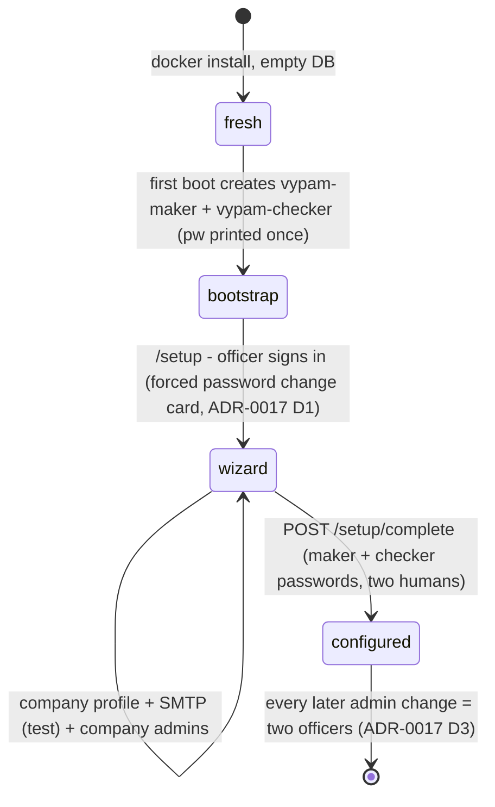

# ADR-0018: First-run setup - VY-PAM bootstrap officers, real configuration, tenancy branding

Date: 2026-10-19
Status: Accepted (user directive, 2026-10-19, verbatim in spirit: "when a
company purchased it and installed it, there should be a first configuration
page to configure all things - username, mail (SMTP), admins and their data;
2 users are always configured from the VY-PAM side as maker-checker for the
install; with those users everything else is configured; those 2 use
passwords; they make the company's users admins; then all admin changes
always need 2 admins; the console must show the company's identity - logo,
'VY-PAM by VY-Groups for X company' - a proper way to configure and manage
this tool, not randomly seeded data")

## Context - today the only "install" is demo data

The rigs and CI boot with `tools/demo_seed.py` - a **test** fixture that
invents users, licenses and bindings. There is no productised first-run:
no instance profile (company name/logo), no bootstrap identity that VY-PAM
ships with the install, and the console header is hard-coded. A purchasing
company therefore starts from seeded fiction instead of its own data.

Facts the design leans on (all checked, no guessing):

| Fact | Evidence |
|---|---|
| the users table empty + no admin token = a fresh install has **no** console identity at all | identity.py create_user only runs when someone calls it; CI rigs call demo_seed |
| `must_change_password` + a one-time password shown **once** is the established disclosure pattern | identity.py:465-493 (admin reset), routes.py:3522-3524 ("Shown once - store it now.") |
| SMTP already has a full settings group + a live test endpoint | openapi:6281 `POST /settings/smtp/test`; settings groups list service.py settings enumeration |
| two-officer attestation with requester refusal is the house pattern | gateway.py:483-487, identity.py:1342-1343, service.py:7197-7204 |
| the console already fetches public bootstrap data at boot (whoami, health) | AuthProvider/QueryProvider patterns |

## Decision 1 - bootstrap officers (batch 11.11, backend)

On **first boot only** - when the users table is empty AND setup is not
completed - the app creates exactly two console identities from the
VY-PAM side:

- `vypam-maker` and `vypam-checker`, both `source=local`, `active`,
  `must_change_password=True`, each with a generated one-time password
  (the same `pysecrets.token_urlsafe(18)` class the admin reset uses,
  NIST-14 policy-checked).
- the two plaintexts are printed **once** to the server log (container
  stdout on `docker logs`) with the honest "Shown once - store it now."
  notice - the emergency-seal/admin-reset disclosure rule, no email
  required to bootstrap (SMTP is configured *by* these accounts, so it
  cannot be a dependency of creating them).
- each gets the `admin` role through the normal `kind: user` binding, so
  every existing admin endpoint works with their console session and the
  RBAC/ABAC machinery governs them like anyone else. They are **not** an
  API token; the machine admin token stays a separate, CI-only path.
- audited (`auth.bootstrap.created`, actor `system:bootstrap`), idempotent
  (never on a non-empty user table), and they are ordinary users the
  company may retire after setup (documented, not automatic).

## Decision 2 - the setup surface (batch 11.11, backend)

A small `setup` API next to the existing tags - the wizard writes through
existing endpoints wherever they already exist (SMTP, users, bindings):

- `GET /api/v1/setup/state` - **public** (the login page needs it for
  branding): `{configured, company_name, logo_data_uri, contact_email,
  smtp_configured, bootstrap: {maker: "vypam-maker", checker:
  "vypam-checker"}}`. No secrets, ever.
- `PUT /api/v1/setup/profile {company_name, logo_data_uri, contact_email}`
  - while `configured=false`, requires a **bootstrap officer console
  session** (maker or checker); the logo is a bounded data-URI (PNG/JPEG
  <= 64 KB, honest refusal beyond).
- SMTP step: the **existing** `PUT /settings/smtp` + `POST
  /settings/smtp/test` (verbatim failure while unconfigured - the rig has
  no SMTP, the wizard must show the server's honest answer).
- company admins step: the **existing** `POST /api/v1/users` +
  `POST /api/v1/role-bindings {principal, role: admin, kind: user}`.
- `POST /api/v1/setup/complete {maker_password, checker_password}` - the
  maker-checker attestation from minute zero: both bootstrap passwords are
  verified against their rows in one request (two humans, two live
  authentications); either wrong -> verbatim 401; on success
  `setup_completed_at` is stamped, `configured` flips true, audited
  (`setup.completed`, both officers recorded). After this, ADR-0017
  Decision 3 governs every admin change (the "always 2 admins" rule).
- while `configured=false`, the mutating setup routes and the admin
  surface refuse non-bootstrap sessions honestly; while `configured=true`,
  `PUT /setup/profile` remains an admin route (company can rebrand) and
  `POST /setup/complete` is a permanent 409 ("setup already completed").

## Decision 3 - tenancy branding (batch 11.11, frontend)

- the login card and the app shell consume `GET /setup/state`: unbranded
  -> the honest default "VY-PAM by VY-Groups"; branded -> the logo +
  "VY-PAM by VY-Groups for <company_name>" (the user's words). No
  hard-coded fiction; the data is the company's own.
- `/setup` is an F4-native route reachable **only** while
  `configured=false` (after completion it honest-redirects to sign-in);
  the wizard is multi-step with the backend's verbatim answers at every
  step (no optimistic "done" without the server saying so).

## Decision 4 - real-infrastructure evidence (the user's testing rule)

Testing uses **real machines, not seeded fiction** (user: "use docker
images - different linux images, windows images - add machines details,
make real users; do real things, not just seeded data"):

- a `Temp/` (never staged) compose fleet of real Linux targets - debian
  bookworm, alpine 3.20, rocky 9 minimal, each running real sshd
  (linuxserver/openssh-server) on published ports, with real host:port
  details onboarded into the instance (discovery assets, vault items,
  session targets) - proving ADR-0017's least-privilege story on real
  endpoints: a scoped user reaches only its granted target, the
  out-of-scope session is refused **verbatim** (routes.py:206-230).
- the setup wizard is proven on a **clean-install rig** (no demo_seed at
  all): boot -> bootstrap credentials from the log -> wizard -> real
  company admins -> sign in. This rig replaces "seeded data" as the
  install evidence; the demo-seeded rigs stay for CI parity only.
- real mail: when the user provides the mailbox, `POST /settings/smtp/test`
  + the recovery OTP run against the real SMTP provider end-to-end; until
  then every SMTP claim stays the rig's honest failure.
- Windows targets: honest scope note - Windows *containers* need Windows
  Docker mode (Hyper-V), unavailable on this machine; the RDP/JIT
  contract for Windows machines is prepared but its execution evidence
  must come from a real Windows host later. No fake "windows tested"
  claims, ever.

## Batch table

*(renumbered 2026-10-19: this batch moved 11.10 -> 11.11 when ADR-0019
inserted PostgreSQL as batch 11.9; the program order is unchanged - setup
still lands after identity hardening)*

| Batch | Surface | Contract delta | Evidence bar |
|---|---|---|---|
| 11.11 | openapi + backend + console | `/setup` state/profile/complete + bootstrap first-boot hook | backend tests (bootstrap idempotence, complete refusals, dual passwords), clean-install rig walkthrough captured verbatim, vitest+axe wizard, branding live on the rig |
| (deps) | - | forced change card (ADR-0017 D1) reused for the officers' first sign-in | batch 11.8 |
